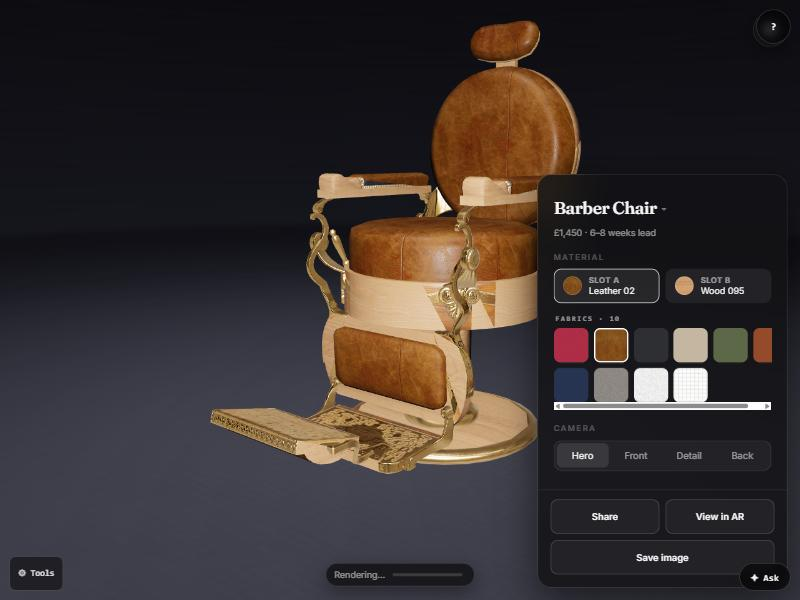

# three.js product configurator

A realistic 3D product configurator built on [three.js](https://threejs.org/). It draws with a fast live renderer while you move, then resolves a path-traced photo render in the browser as soon as the view is still: true mirror reflections, glass, brushed steel and soft studio shadows.

**[Live demo](https://niallarnfieldcom.github.io/threejs-product-configurator/)**



The demo scene is the **Fern Room**, a two-chair salon station modelled in Blender for this project. Choose the leather and the timber; the steel, glass, ceramic and planting keep the materials they were authored with. Prices are sample values.

## How it works

| File | Job |
| --- | --- |
| `src/scene-config.js` | The scene as data: model, configurable slots, finishes, camera views, price, and the URL state helpers. |
| `src/studio.js` | The photo studio: a procedural HDR panorama of soft boxes, a seamless floor, and a shadow light for the live renderer. No HDRI download. |
| `src/finishes.js` | Applies finishes. A colour finish turns the authored texture into a neutral grain map and tints it, so new colours keep the leather's mottling and the timber's figure. |
| `src/photo-tracer.js` | The path-traced photo render ([three-gpu-pathtracer](https://github.com/gkjohnson/three-gpu-pathtracer)), loaded only on devices that will use it. |
| `src/capabilities.js` | Chooses a render tier per device: `basic`, `live`, `mobile` or `traced`. |
| `src/main.js` | Renderer, camera, UI wiring, share links, AR and embed messaging. |

A few decisions worth copying:

- **One lighting description, two renderers.** The path tracer importance-samples the studio panorama, so its soft boxes behave as area lights. The live renderer prefilters a version of the same panorama and adds one shadow-casting light aligned with the key.
- **The photo render is automatic.** It starts 0.2 s after the camera stops, accumulates off-screen, and cross-fades over the live frame once it is clean enough to show. Any interaction returns to the live renderer instantly.
- **It stops when it is done.** Tracing ends at 480 samples and the GPU goes idle.
- **Phones get it too, carefully.** Capable phones and tablets run a lighter photo render (lower resolution, 200 samples, shorter paths, more denoising). If an attempt crashes the tab or loses the graphics context, the device stays on the live renderer for the rest of the session. Low-power devices never download the tracer at all.
- **Small payload.** The whole scene is one 4 MB Draco-compressed GLB. The initial JavaScript is about 220 KB gzipped, and the tracer is a separate 61 KB chunk.
- **State lives in the URL.** `?a=cognac&b=oak&view=chair` restores a configuration, and invalid values fall back to the defaults.

## Run it

```bash
npm install
npm run dev      # http://localhost:5174/
npm test         # scene config, URL state and render-tier rules
npm run build
```

Add `?render=live` to stay on the live renderer, or `?render=traced` to force the photo render.

## Use your own product

1. Model the product with one object per configurable part, named `a`, `b` and so on. `tools/prepare-scene.py` shows how the Fern Room was split by material in Blender (`npm run prepare:scene -- path/to/export.glb`).
2. Export a Draco-compressed GLB to `public/assets/<id>/model.glb`.
3. Edit `src/scene-config.js`: the model path, the slots and their finishes, and the camera views.
4. Run `npm test`, which checks the GLB has a node for every slot.

## Embedding

Add `?embed=1` to hide the built-in panel and drive the configurator from your own page with `postMessage`. `public/embed-example.html` is a working example ([live](https://niallarnfieldcom.github.io/threejs-product-configurator/embed-example.html)).

| Message | Direction | Payload |
| --- | --- | --- |
| `configurator:ready` | out | `scene`, `slots` (with finishes), `views` |
| `configurator:change` | out | `state` (scene and chosen finish names) |
| `configurator:event` | out | analytics events: `ready`, `finish`, `view`, `share`, `save_image`, `ar_open` |
| `configurator:setFinish` | in | `slot`, `finish` |
| `configurator:setView` | in | `view` |

Messages are only exchanged with the origin given in `?parentOrigin=` or `window.CONFIGURATOR_BRAND.parentOrigin`.

Optional globals, set before the app loads: `CONFIGURATOR_PRICING` (`{ price, leadTime, approved }`; prices show only when `approved` is true) and `CONFIGURATOR_ANALYTICS` (a function that receives each event; events are also pushed to `dataLayer`).

Set `BASE_PATH` when building for a sub-path, for example `BASE_PATH=/threejs-product-configurator/ npm run build` for GitHub Pages.

## Background

The approach behind this, from product rules to performance budgets, is written up in the [3D product configurator guide](https://niallarnfield.com/3d-product-configurator/) on niallarnfield.com.

Built by [Niall Arnfield](https://niallarnfield.com), who designs and builds 3D product configurators for ecommerce.

## Licence

Copyright (c) 2026 Niall Arnfield. All rights reserved. The source is published to be read and linked to, not reused: see [LICENSE](LICENSE). For a configurator built on this framework, or a licence to use it, get in touch through [niallarnfield.com](https://niallarnfield.com).

Third-party components keep their own licences, listed in [THIRD-PARTY-NOTICES.md](THIRD-PARTY-NOTICES.md).
